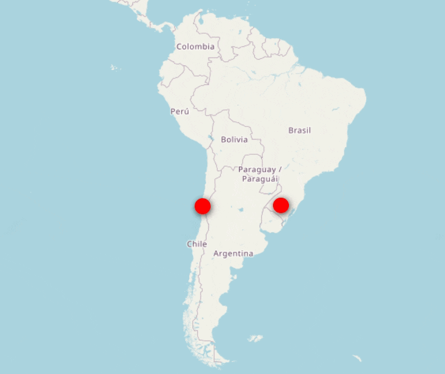

+++
title = "Sobre / Acerca de"
+++

## Collaborative Online International Learning (COIL)

### 🇧🇷 Brasil–Chile · 2026

COIL é uma modalidade de ensino e aprendizagem online que reúne professores e estudantes de diferentes países em atividades colaborativas integradas às disciplinas.

Nesta edição, a Universidade Federal de Santa Maria (UFSM), Brasil, e o Instituto Nacional de Capacitación Profesional (INACAP), Chile, colaboraram em um tema comum: **sustentabilidade de pequenas e médias empresas**.

A experiência articulou **Desenvolvimento de Software para Web**, na UFSM, e **Administração**, no INACAP. As equipes chilenas contribuíram com o conteúdo de sustentabilidade, os requisitos e a validação; as equipes brasileiras desenvolveram as aplicações web. A interação entre as áreas orientou a interpretação das necessidades, as decisões sobre as funcionalidades e os ajustes dos protótipos.

As cinco equipes binacionais produziram soluções que apoiam o diagnóstico de sustentabilidade, a identificação de oportunidades de melhoria e o planejamento de ações. Cada projeto apresenta escolhas próprias de interface, arquitetura e tecnologias.

### 🇨🇱 Brasil–Chile · 2026

COIL es una modalidad de enseñanza y aprendizaje en línea que reúne a docentes y estudiantes de distintos países en actividades colaborativas integradas en las asignaturas.

En esta edición, la Universidade Federal de Santa Maria (UFSM), Brasil, y el Instituto Nacional de Capacitación Profesional (INACAP), Chile, colaboraron en un tema común: **sostenibilidad de pequeñas y medianas empresas**.

La experiencia articuló **Desarrollo de Software para la Web**, en la UFSM, y **Administración**, en INACAP. Los equipos chilenos contribuyeron con el contenido de sostenibilidad, los requisitos y la validación; los equipos brasileños desarrollaron las aplicaciones web. La interacción entre las áreas orientó la interpretación de las necesidades, las decisiones sobre las funcionalidades y los ajustes de los prototipos.

Los cinco equipos binacionales produjeron soluciones que apoyan el diagnóstico de sostenibilidad, la identificación de oportunidades de mejora y la planificación de acciones. Cada proyecto presenta sus propias decisiones de interfaz, arquitectura y tecnologías.

[Ver os cinco projetos / Ver los cinco proyectos](../portfolio/)
